<p align="right">
  <a href="README.md"></a>
</p>

<div align="center">

<a href="https://web-production-88238.up.railway.app">
  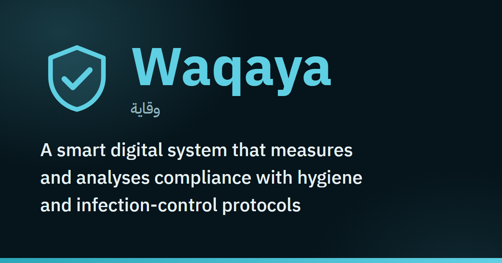
</a>


<h3>Measure infection-control compliance as it really happens, not as it's assumed</h3>

<p>Realistic training simulations, an AI-assisted camera audit of real areas, and reports that show exactly where things break down, all in one platform.</p>

<p>
  <a href="https://web-production-88238.up.railway.app"></a>
  &nbsp;
  <a href="#-explainer-video"></a>
</p>

<p>
  
  
  
  
  
  
  
</p>

</div>

> [!IMPORTANT]
> **This repository is for viewing only by the judges of the**  **hackathon.**
>
> © 2026 the Waqaya team. All rights reserved. No part of this code may be copied, used, modified, republished or distributed, in whole or in part, without prior written permission. There is no open-source license.

## 🎬 Explainer video

<div align="center">

<a href="docs/video/waqaya-explainer.mp4">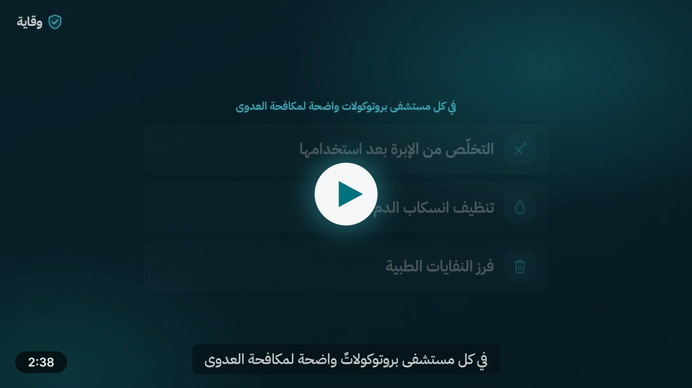</a>

<sub>Two and a half minutes on the problem, the solution, an examiner's work today versus with Waqaya, and a walk through the platform (narrated in Arabic) · <a href="docs/video/waqaya-explainer.mp4">Open the video</a></sub>

</div>

## 📑 Contents

<table>
<tr>
<td valign="top" width="50%">

- [💡 Why Waqaya?](#-why-waqaya)
- [✨ Key features](#-key-features)
- [🔄 How it works](#-how-it-works)
- [🧮 How scores are calculated](#-how-scores-are-calculated)
- [👥 Roles and permissions](#-roles-and-permissions)
- [📚 Medical content](#-medical-content)

</td>
<td valign="top" width="50%">

- [🏗️ Architecture](#️-architecture)
- [🔒 Security and privacy](#-security-and-privacy)
- [✅ Quality and testing](#-quality-and-testing)
- [🗂️ Repository layout](#️-repository-layout)
- [💻 Running locally](#-running-locally)
- [⚖️ Rights and usage](#️-rights-and-usage)

</td>
</tr>
</table>

## 💡 Why Waqaya?

Healthcare facilities don't lack protocols. What they lack is **real compliance with them, and a way to measure it**. Waqaya turns compliance behaviour into **data that can be scored, analysed and acted on**: from discovering a failure after it happens, to catching it before it becomes a risk.

| Today | With Waqaya |
|---|---|
| Theory-based training that never shows what staff will actually do in the moment | **Realistic simulations** where trainees decide step by step, and every mistake is explained |
| Paper audit rounds that rely on memory and impressions | **AI-assisted photo audits** that check the area against each protocol step, with the examiner making the final call |
| Scattered numbers that don't say where the gap is or what to do next | **Dashboards and reports** that surface the most frequent gaps and the training that closes them |

<table>
<tr>
<td align="center" width="16%">📋<br><b>8</b><br><sub>core protocols</sub></td>
<td align="center" width="16%">🎬<br><b>10</b><br><sub>simulation scenarios</sub></td>
<td align="center" width="16%">👥<br><b>5</b><br><sub>roles</sub></td>
<td align="center" width="16%">🌐<br><b>2</b><br><sub>full languages</sub></td>
<td align="center" width="16%">🧪<br><b>116</b><br><sub>unit test files</sub></td>
<td align="center" width="16%">🧭<br><b>42</b><br><sub>end-to-end specs</sub></td>
</tr>
</table>

## ✨ Key features

<table>
<tr>
<td align="center" width="33%">🎓<br><b>Simulations</b><br><sub>for trainees</sub></td>
<td align="center" width="33%">📷<br><b>Smart scan</b><br><sub>for examiners</sub></td>
<td align="center" width="33%">📊<br><b>Reports and dashboards</b><br><sub>for management</sub></td>
</tr>
</table>

### 🎓 Simulations: training on real situations

A trainee steps into a realistic hospital scenario (a blood spill in a patient's room, a used needle after an injection, waste from a dressing round…) and makes decisions stage by stage.

- Every choice maps to a specific protocol step, and every mistake is explained on the spot.
- The attempt ends with a score and a risk level, then a **personal AI debrief** on what to focus on next.

<table>
<tr>
<td width="50%">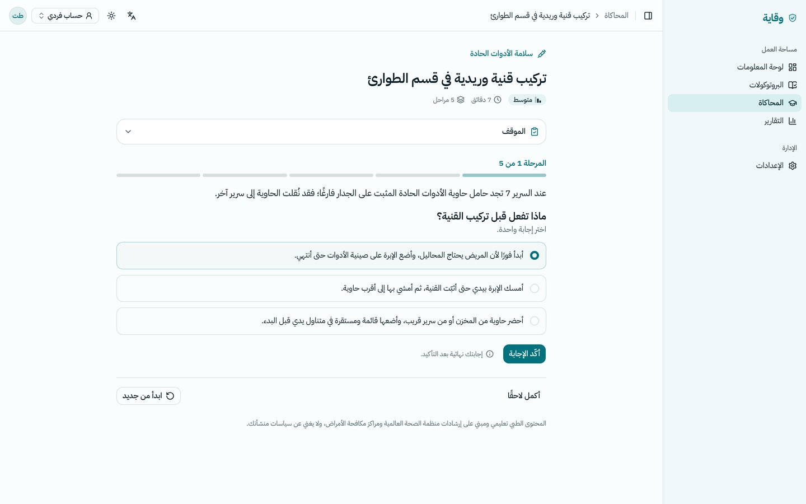</td>
<td width="50%">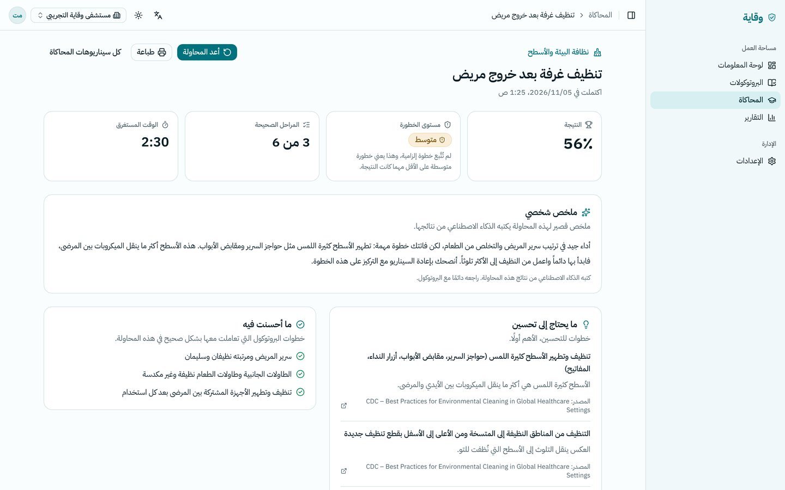</td>
</tr>
<tr>
<td align="center"><sub>A simulation in progress</sub></td>
<td align="center"><sub>The result and the AI debrief</sub></td>
</tr>
</table>

### 📷 Smart scan: photo audits, human decisions

An examiner photographs a real area (a sink, a sharps container, a waste corner…) and AI vision checks the photos against the protocol steps that can actually be seen.

- Each step gets a verdict: **compliant / non-compliant / not visible**, with a confidence level and written evidence from the photo.
- **A human always makes the final call**: the examiner reviews, overrides where needed, and finalises the report.

<p align="center">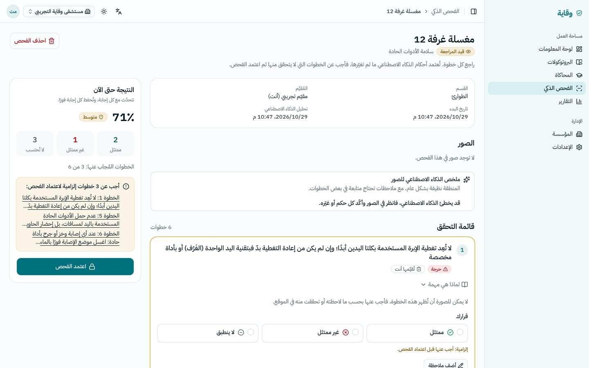</p>

### 📊 Reports and dashboards: where is the gap?

- **For each trainee:** a personal history and recurring weak steps.
- **For the institution:** compliance trend, breakdown by protocol and department, the most frequent gaps with the recommended training for each, and trainee progress.
- A printable report and CSV export.

<p align="center">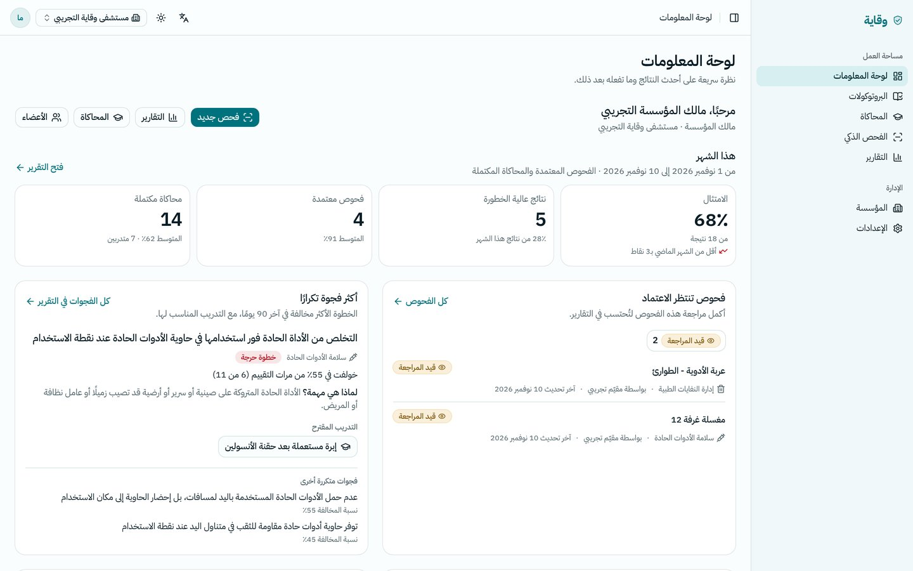</p>

### 🏥 And also

| | Feature | What it gives you |
|---|---|---|
| 🏥 | **Institution management** | Role-based invitations, departments, and custom copies of the global protocols |
| 🛠️ | **Platform admin** | Users and organizations, a protocol and scenario editor with preview, AI settings, and an audit log of every sensitive action |
| 🌐 | **Two full languages** | Right-to-left Arabic and left-to-right English, with the medical content itself in both |
| 📱 | **Mobile first** | Scans and simulations are designed to be used on a phone inside the wards |

**Nothing is mocked:** every number on every screen comes from the database, and empty states say so.

<details>
<summary><b>🖼️ More screenshots: home page and mobile</b></summary>
<br>

<p align="center">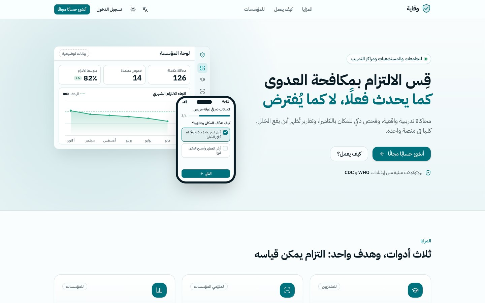</p>
<p align="center">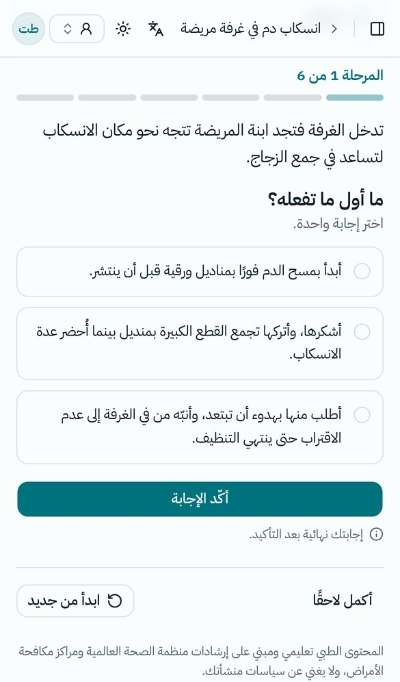</p>

</details>

## 🔄 How it works

One closed loop: training reveals the gap, audits measure it in the real world, and reports aim the next round of training at it.

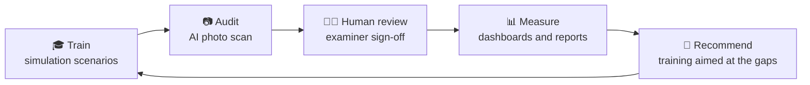

<details>
<summary><b>🔍 The smart scan, step by step</b></summary>
<br>

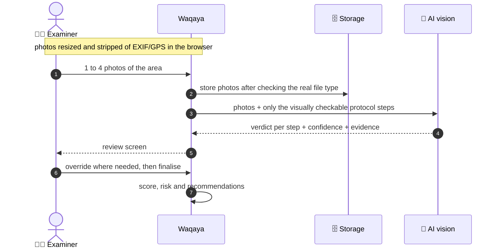

- The analysis is not tied to the phone's connection: if the connection drops mid-analysis, the result is still saved with the scan.
- If the analysis fails, the examiner can retry or answer every step by hand.

</details>

## 🧮 How scores are calculated

**One** scoring model serves both simulations and scans, in [`lib/scoring.ts`](lib/scoring.ts), covered by unit tests.

Each step has a weight $w$ from 1 to 3. The score is the weight of the compliant steps $C$ over the weight of the applicable steps $A$:

$$S = 100 \times \frac{\sum_{i \in C} w_i}{\sum_{i \in A} w_i}$$

| Risk level | When |
|---|---|
| 🔴 **High** | A critical step was violated (such as recapping a needle), or the score is below 50 |
| 🟠 **Medium** | A mandatory step was violated, or the score is below 80 |
| 🟢 **Low** | Otherwise |

- **Recommendations** are built from the violated steps (the reason and the matching training scenario), and AI writes a personal summary on top. The rule-based list is always there, even if the AI call fails.
- When no step applies, the result is **not assessable** rather than zero, so dashboards don't inflate the high-risk share.

## 👥 Roles and permissions

| Role | Can |
|---|---|
| 🛡️ Platform admin | Everything, including the admin panel |
| ✍️ Protocol editor | Edit the global protocols and scenarios |
| 🏥 Institution owner or admin | Members, invitations, departments, institution protocols, and all institution data |
| 📷 Examiner | Run, review and finalise scans; institution dashboards and trainee results |
| 🎓 Trainee | Simulations, personal results and recommendations (any user without an institution starts as a trainee) |

## 📚 Medical content

**8 core protocols** and **10 simulation scenarios** built on them. Every step has a rationale ("why it matters") and a reference to **WHO** and **CDC** guidance.

| Protocol | Protocol |
|---|---|
| 💉 Sharps safety | 🧼 Sinks and hand-hygiene stations |
| 🗑️ Medical waste management | 🧪 Specimen and culture areas |
| 🩸 Blood and body-fluid spills | 🍽️ Food and drink in clinical areas |
| 🧽 Environmental and surface cleaning | 🔧 Equipment and facility maintenance schedule |

> The content is educational and is reviewed by the team's medical members before institutional use.

## 🏗️ Architecture

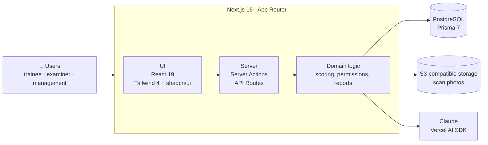

| Layer | Technology |
|---|---|
| App and server |    |
| Design and languages |    |
| Data |    |
| Auth |  roles, organizations and invitations, rate limiting, account deletion |
| AI |   vision and summaries, structured output, a daily limit per user |
| Hosting |  app, database and storage |
| Quality |    |

## 🔒 Security and privacy

- 🛡️ **Strict security headers:** Content Security Policy, HSTS and more.
- 🖼️ **Photos:** location metadata (EXIF/GPS) is stripped in the browser before upload, the real file type is verified, and photos are deleted automatically after the retention period.
- 🏢 **Strict separation** of each institution's data.
- 📝 **Audit log** of every sensitive action, and server logs without personal data.
- ⏱️ **Usage limits:** rate-limited sign-in, and a daily cap on AI calls per user.
- 🗑️ **Account deletion** that cleans up the related data.

## ✅ Quality and testing

| Check | Tool | Size |
|---|---|---|
| Unit tests | Vitest | 116 test files |
| End-to-end tests on desktop and mobile | Playwright + accessibility checks (axe) | 42 spec files |
| Types and lint | TypeScript · ESLint (zero warnings) | All code |
| Translation completeness | Arabic and English key check | All strings |
| Continuous integration | GitHub Actions on every push | Automatic |

## 🗂️ Repository layout

```text
.
├── app/
│   ├── [locale]/        # pages in Arabic & English: landing, auth, app, account
│   └── api/             # scans, simulations, reports, admin, health
├── components/          # UI components per feature
├── lib/                 # domain logic: scoring, AI, scans, simulations, reports, permissions
├── messages/            # UI strings: ar/ and en/
├── prisma/              # schema, migrations, seed (protocols & scenarios)
├── e2e/                 # Playwright end-to-end tests
└── docs/                # screenshots, explainer video, README assets
```

## 💻 Running locally

**Requirements:** Node 24 · pnpm 11 · PostgreSQL (for example via Docker).

```bash
cp .env.example .env.local      # BETTER_AUTH_SECRET, DATABASE_URL, optional ANTHROPIC_API_KEY
pnpm install
pnpm db:migrate                 # apply migrations
pnpm db:seed                    # protocols & scenarios
ADMIN_EMAIL=you@example.com ADMIN_INITIAL_PASSWORD='<long random password>' pnpm db:seed-admin
pnpm dev                        # http://localhost:3000
```

- Without an AI key the platform still runs and shows "AI is not configured".
- With `EMAIL_PROVIDER=console`, verification codes are printed to the server log.
- To run every check: `pnpm typecheck && pnpm lint && pnpm test && pnpm i18n:check && pnpm build`

> [!NOTE]
> This repository contains no secrets, passwords or keys. Every variable is documented with an empty value in [`.env.example`](.env.example).

## ⚖️ Rights and usage

This repository is **for viewing only** by the hackathon judges, and carries no open-source license.
© 2026 the Waqaya team. All rights reserved. No part of this code may be copied, used, modified, republished or distributed, in whole or in part, without prior written permission.

<div align="center">
<br>

<a href="https://web-production-88238.up.railway.app"></a>

<b>Waqaya</b> · from finding failures after they happen to catching them before they become a risk

<sub><a href="#top">⬆ Back to top</a></sub>

</div>
