<div dir="rtl">

<p align="left">
  <a href="README.en.md"></a>
</p>

<div align="center">

<a href="https://web-production-88238.up.railway.app">
  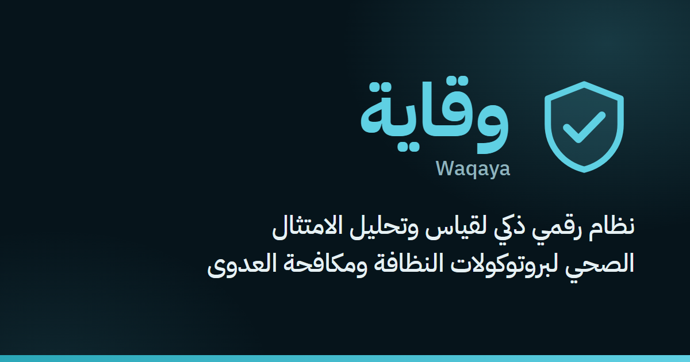
</a>


<h3>قِس الالتزام بمكافحة العدوى كما يحدث فعلًا، لا كما يُفترض</h3>

<p>محاكاة تدريبية واقعية، وفحص ذكي للمكان بالكاميرا، وتقارير تُظهر أين يقع الخلل، كلها في منصّة واحدة.</p>

<p>
  <a href="https://web-production-88238.up.railway.app"></a>
  &nbsp;
  <a href="#-الفيديو-التعريفي"></a>
</p>

<p>
  
  
  
  
  
  
  
</p>

</div>

> ⚠️ **هذا المستودع للاطلاع فقط من قِبل لجنة تحكيم هاكاثون** 
>
> جميع الحقوق محفوظة لفريق وقاية © 2026. لا يُسمح بنسخ الكود أو استخدامه أو تعديله أو إعادة نشره أو توزيعه، كليًا أو جزئيًا، دون إذن كتابي مسبق. لا يحمل المستودع أي رخصة مفتوحة المصدر.

## 🎬 الفيديو التعريفي

<div align="center">

<a href="docs/video/waqaya-explainer.mp4">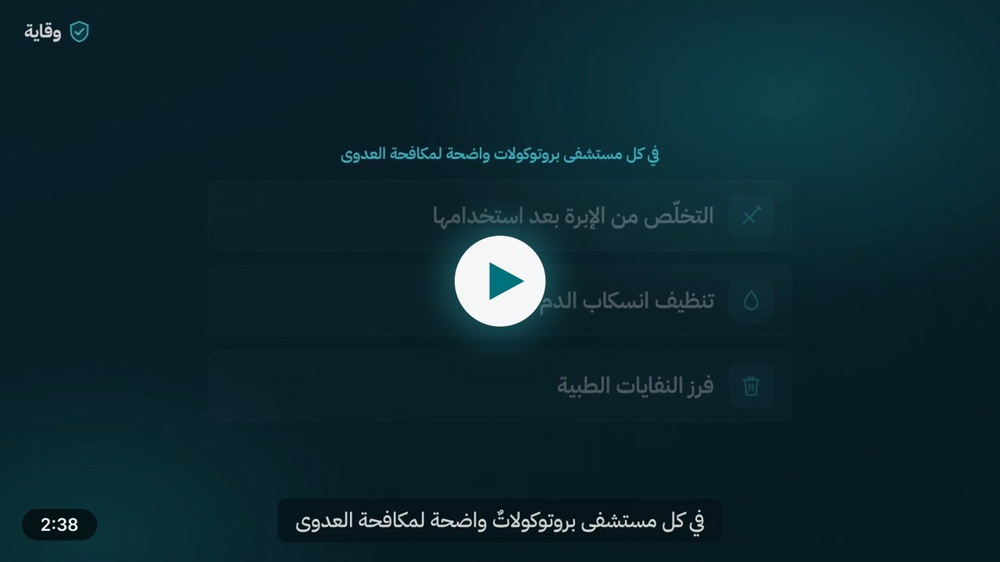</a>

<sub>دقيقتان ونصف تشرح المشكلة والحل، وتقارن عمل المقيّم اليوم مع وقاية، وتعرض المنصّة من الداخل · <a href="docs/video/waqaya-explainer.mp4">افتح الفيديو</a></sub>

</div>

## 📑 المحتويات

<table>
<tr>
<td valign="top" width="50%">

- [💡 لماذا وقاية؟](#-لماذا-وقاية)
- [✨ المزايا الرئيسية](#-المزايا-الرئيسية)
- [🔄 كيف تعمل المنصّة؟](#-كيف-تعمل-المنصّة)
- [🧮 كيف تُحسب النتيجة؟](#-كيف-تُحسب-النتيجة)
- [👥 الأدوار والصلاحيات](#-الأدوار-والصلاحيات)
- [📚 المحتوى الطبي](#-المحتوى-الطبي)

</td>
<td valign="top" width="50%">

- [🏗️ البنية التقنية](#️-البنية-التقنية)
- [🔒 الأمان والخصوصية](#-الأمان-والخصوصية)
- [✅ الجودة والاختبارات](#-الجودة-والاختبارات)
- [🗂️ هيكل المستودع](#️-هيكل-المستودع)
- [💻 التشغيل محليًا](#-التشغيل-محليًا)
- [⚖️ الحقوق والاستخدام](#️-الحقوق-والاستخدام)

</td>
</tr>
</table>

## 💡 لماذا وقاية؟

المشكلة في المنشآت الصحية ليست غياب البروتوكولات، بل **ضعف الامتثال الفعلي لها وصعوبة قياسه**. وقاية تحوّل سلوك الامتثال إلى **بيانات قابلة للقياس والتحليل والتصرّف**: من اكتشاف الخلل بعد وقوعه، إلى التنبّه له قبل أن يتحوّل إلى خطر.

| الواقع اليوم | مع وقاية |
|---|---|
| تدريب نظري لا يقيس ماذا سيفعل الموظف أمام الموقف الحقيقي | **محاكاة لمواقف حقيقية** يتخذ فيها المتدرّب قراره خطوةً بخطوة، ويُشرح له كل خطأ |
| جولات تدقيق ورقية تعتمد على الذاكرة والانطباع | **فحص ذكي بالصور** يقارن الموقع بخطوات البروتوكول، والقرار النهائي للمقيّم |
| أرقام متفرّقة لا تقول أين يقع الخلل ولا ماذا نفعل | **لوحات وتقارير** تُظهر أكثر الفجوات تكرارًا، والتدريب المقترح لسدّها |

<table>
<tr>
<td align="center" width="16%">📋<br><b>8</b><br><sub>بروتوكولات أساسية</sub></td>
<td align="center" width="16%">🎬<br><b>10</b><br><sub>سيناريوهات محاكاة</sub></td>
<td align="center" width="16%">👥<br><b>5</b><br><sub>أدوار وصلاحيات</sub></td>
<td align="center" width="16%">🌐<br><b>2</b><br><sub>لغتان كاملتان</sub></td>
<td align="center" width="16%">🧪<br><b>116</b><br><sub>ملف اختبار وحدات</sub></td>
<td align="center" width="16%">🧭<br><b>42</b><br><sub>اختبار شامل</sub></td>
</tr>
</table>

## ✨ المزايا الرئيسية

<table>
<tr>
<td align="center" width="33%">🎓<br><b>المحاكاة</b><br><sub>للمتدرّبين</sub></td>
<td align="center" width="33%">📷<br><b>الفحص الذكي</b><br><sub>لمقيّمي المؤسسة</sub></td>
<td align="center" width="33%">📊<br><b>التقارير ولوحات المعلومات</b><br><sub>للإدارة</sub></td>
</tr>
</table>

### 🎓 المحاكاة: تدريب على مواقف حقيقية

يدخل المتدرّب سيناريو واقعيًا في المستشفى (انسكاب دم في غرفة مريضة، إبرة مستعملة بعد حقنة، نفايات جولة الضمادات…) ويتخذ قراراته مرحلةً بمرحلة.

- كل خيار مرتبط بخطوة محدّدة في البروتوكول، وكل خطأ يُشرح فورًا مع سببه.
- في النهاية نتيجة ومستوى خطورة، ثم **ملخّص شخصي بالذكاء الاصطناعي** يشرح ما الذي يحتاج المتدرّب أن يركّز عليه.

<table>
<tr>
<td width="50%">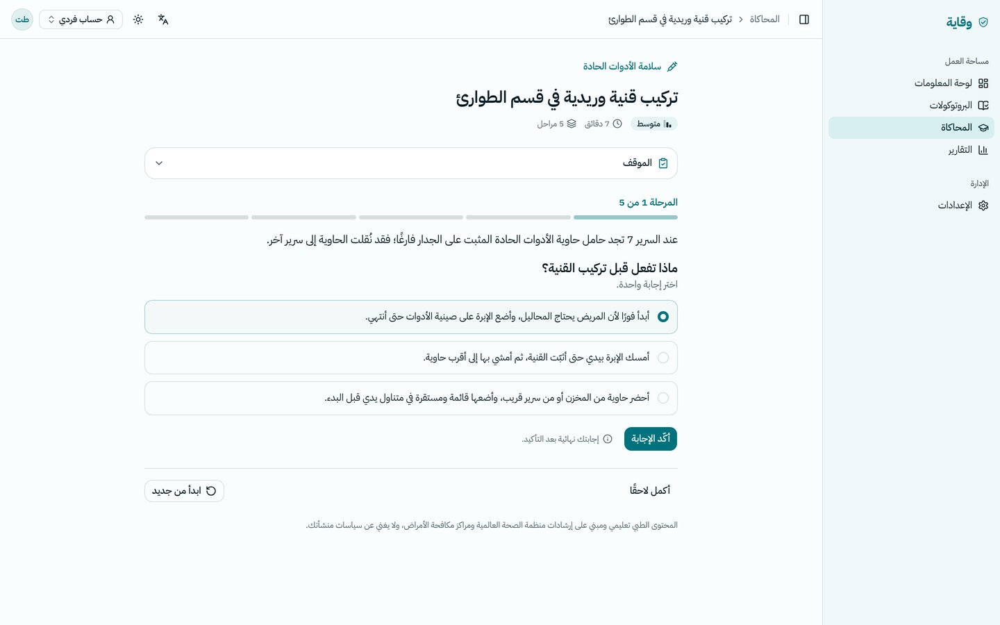</td>
<td width="50%">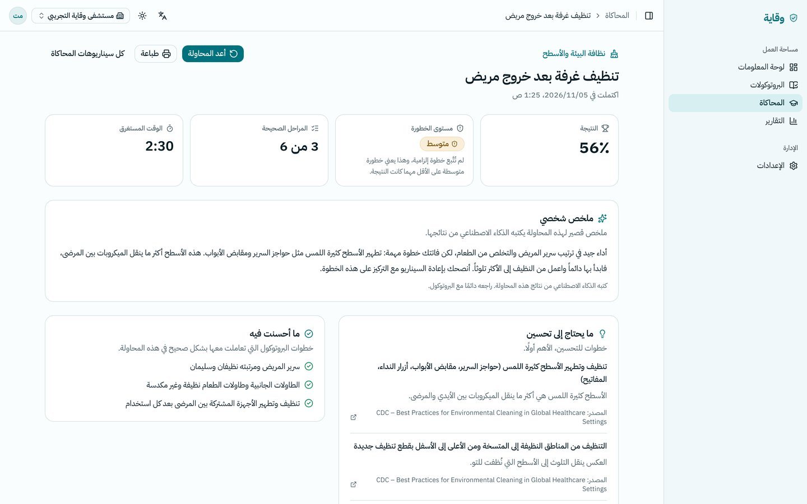</td>
</tr>
<tr>
<td align="center"><sub>المحاكاة أثناء التدريب</sub></td>
<td align="center"><sub>النتيجة وملخّص الذكاء الاصطناعي</sub></td>
</tr>
</table>

### 📷 الفحص الذكي: تدقيق بالصور والقرار للإنسان

يصوّر المقيّم موقعًا حقيقيًا (مغسلة، حاوية أدوات حادة، ركن نفايات…)، فيحلّل الذكاء الاصطناعي الصور مقابل خطوات البروتوكول التي يمكن رؤيتها.

- لكل خطوة حكم: **ممتثل / غير ممتثل / غير ظاهر**، مع درجة ثقة ودليل مكتوب من الصورة.
- **القرار النهائي للإنسان دائمًا**: المقيّم يراجع ويعدّل الأحكام ثم يعتمد التقرير.

<p align="center">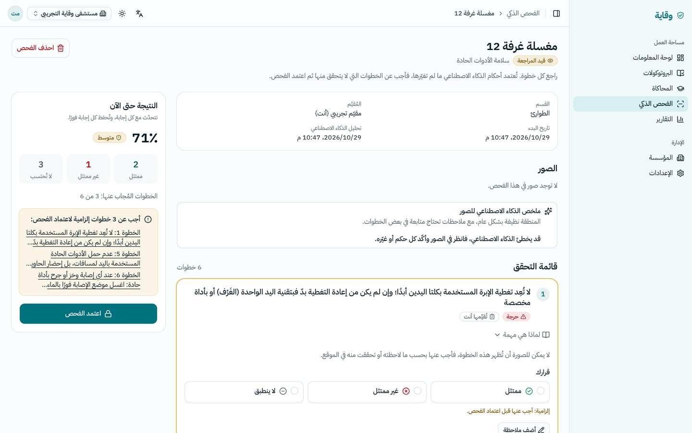</p>

### 📊 التقارير ولوحات المعلومات: أين يقع الخلل؟

- **لكل متدرّب:** سجل شخصي ونقاط الضعف المتكرّرة.
- **للمؤسسة:** اتجاه الامتثال، التوزيع حسب البروتوكول والقسم، أكثر الفجوات تكرارًا مع التدريب المقترح لكل منها، وتقدّم المتدرّبين.
- تقرير قابل للطباعة وتصدير CSV.

<p align="center">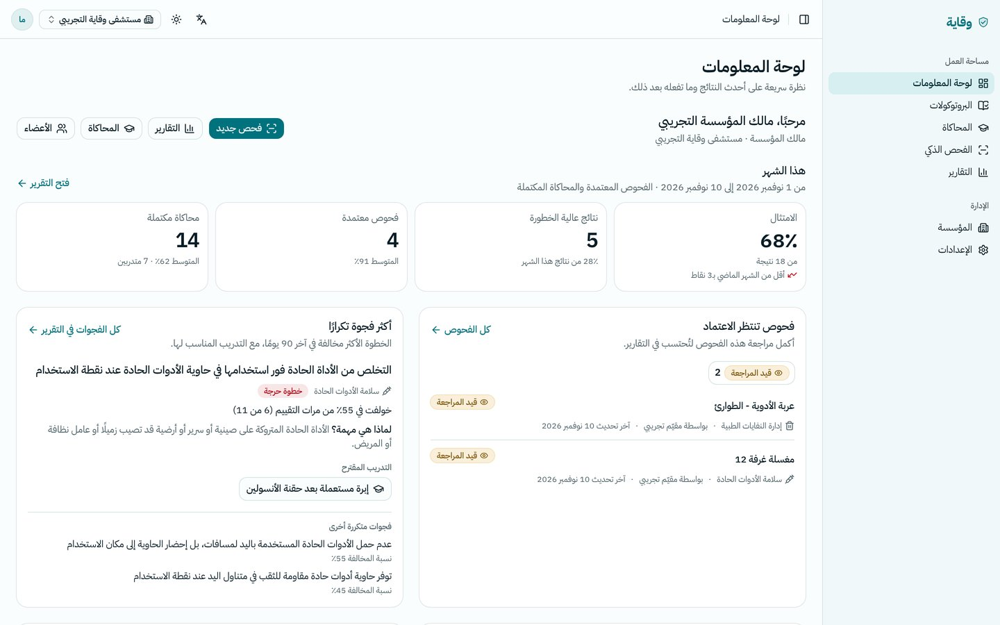</p>

### 🏥 وأيضًا

| | الميزة | ما الذي تقدّمه |
|---|---|---|
| 🏥 | **إدارة المؤسسة** | دعوة الأعضاء بالأدوار، الأقسام، ونسخ البروتوكولات العامة وتخصيصها للمؤسسة |
| 🛠️ | **لوحة إدارة المنصّة** | المستخدمون والمؤسسات، محرّر البروتوكولات والسيناريوهات مع المعاينة، إعدادات الذكاء الاصطناعي، وسجل تدقيق لكل عملية حساسة |
| 🌐 | **لغتان كاملتان** | واجهة عربية من اليمين لليسار وإنجليزية من اليسار لليمين، والمحتوى الطبي نفسه باللغتين |
| 📱 | **تجربة جوال أولًا** | الفحص والمحاكاة مصمّمان للاستخدام بالجوال داخل الأقسام |

**لا شيء وهمي:** كل رقم في كل شاشة يأتي من قاعدة البيانات، والحالات الفارغة تقول ذلك بوضوح.

<details>
<summary><b>🖼️ المزيد من اللقطات: الصفحة الرئيسية وتجربة الجوال</b></summary>
<br>

<p align="center">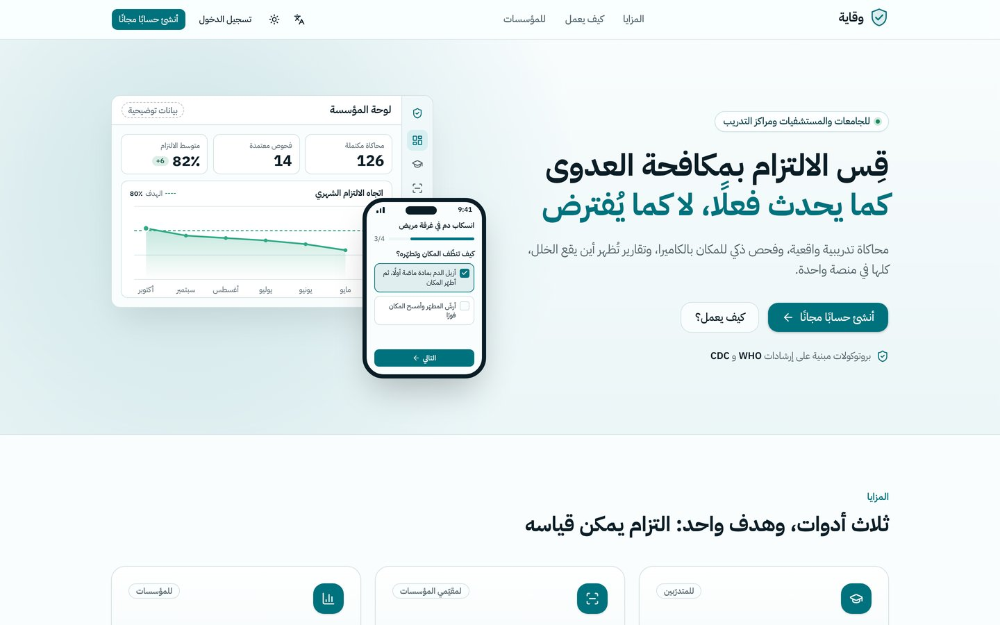</p>
<p align="center">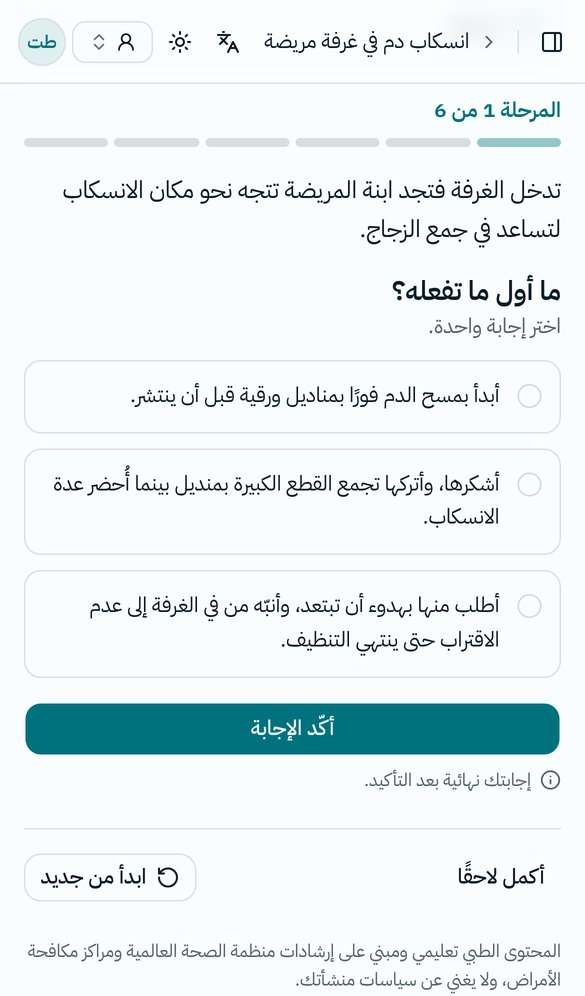</p>

</details>

## 🔄 كيف تعمل المنصّة؟

دورة واحدة متكاملة: التدريب يكشف الفجوة، والتدقيق يقيسها في الواقع، والتقارير توجّه التدريب التالي إليها.

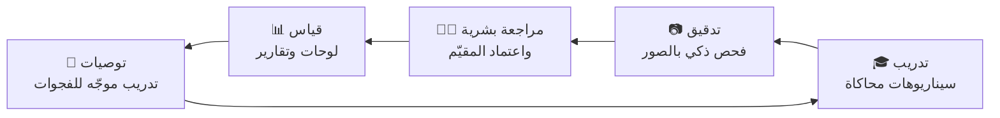

<details>
<summary><b>🔍 مسار الفحص الذكي بالتفصيل</b></summary>
<br>

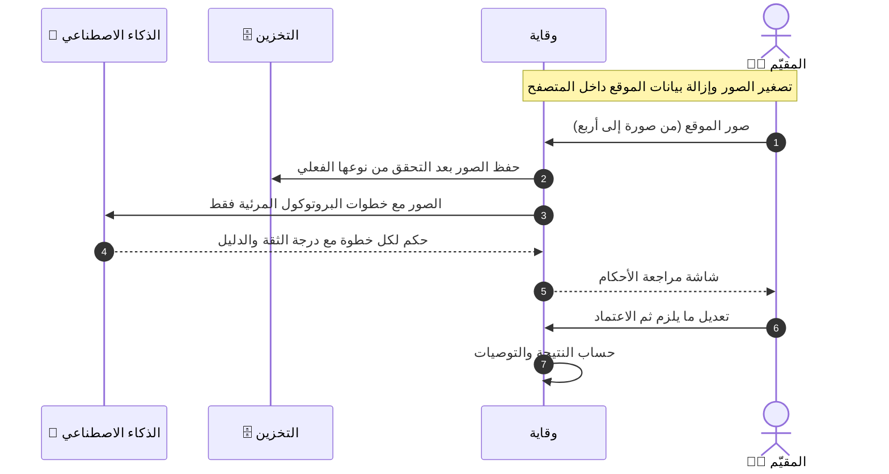

- التحليل لا يرتبط باتصال الجوال: لو انقطع الاتصال أثناء التحليل تُحفظ النتيجة مع الفحص.
- لو تعذّر التحليل، يستطيع المقيّم إعادة المحاولة أو الإجابة عن كل خطوة يدويًا.

</details>

## 🧮 كيف تُحسب النتيجة؟

نموذج تقييم **واحد** للمحاكاة والفحص معًا، في [`lib/scoring.ts`](lib/scoring.ts) ومغطّى باختبارات.

لكل خطوة وزن $w$ من 1 إلى 3. النتيجة هي نسبة أوزان الخطوات الممتثلة $C$ إلى أوزان الخطوات المنطبقة $A$:

$$S = 100 \times \frac{\sum_{i \in C} w_i}{\sum_{i \in A} w_i}$$

| مستوى الخطورة | متى؟ |
|---|---|
| 🔴 **عالية** | خُولفت خطوة حرجة (مثل إعادة تغطية الإبرة)، أو النتيجة أقل من 50 |
| 🟠 **متوسطة** | خُولفت خطوة إلزامية، أو النتيجة أقل من 80 |
| 🟢 **منخفضة** | غير ذلك |

- **التوصيات** تُبنى من الخطوات المخالفة (السبب والسيناريو التدريبي المناسب)، والذكاء الاصطناعي يصوغ فوقها ملخّصًا شخصيًا. القائمة المبنية على القواعد موجودة دائمًا حتى لو تعذّر استدعاء الذكاء الاصطناعي.
- إذا لم تنطبق أي خطوة تكون النتيجة **غير قابلة للتقييم** بدل صفر، حتى لا تتضخّم نسبة الخطورة العالية في اللوحات.

## 👥 الأدوار والصلاحيات

| الدور | الصلاحيات |
|---|---|
| 🛡️ مدير المنصّة | كل شيء، ولوحة الإدارة |
| ✍️ محرّر البروتوكولات | تحرير البروتوكولات والسيناريوهات العامة |
| 🏥 مالك أو مدير المؤسسة | الأعضاء والدعوات والأقسام وبروتوكولات المؤسسة، وكل بيانات المؤسسة |
| 📷 مقيّم | إجراء الفحوص ومراجعتها واعتمادها، ولوحات المؤسسة ونتائج المتدرّبين |
| 🎓 متدرّب | المحاكاة ونتائجه الشخصية وتوصياته (أي مستخدم بلا مؤسسة يبدأ متدرّبًا) |

## 📚 المحتوى الطبي

**8 بروتوكولات** أساسية و**10 سيناريوهات محاكاة** مرتبطة بها. كل خطوة لها سبب ("لماذا هي مهمة؟") ومرجع من إرشادات **WHO** و**CDC**.

| البروتوكول | البروتوكول |
|---|---|
| 💉 سلامة الأدوات الحادة | 🧼 المغسلة ومحطة نظافة اليدين |
| 🗑️ إدارة النفايات الطبية | 🧪 منطقة العينات والمزارع |
| 🩸 التعامل مع انسكاب الدم وسوائل الجسم | 🍽️ سياسة الطعام والشراب في المناطق السريرية |
| 🧽 نظافة البيئة والأسطح | 🔧 جدول صيانة الأجهزة والمرافق |

> المحتوى تعليمي، ويخضع لمراجعة الأعضاء الطبيين في الفريق قبل الاستخدام المؤسسي.

## 🏗️ البنية التقنية

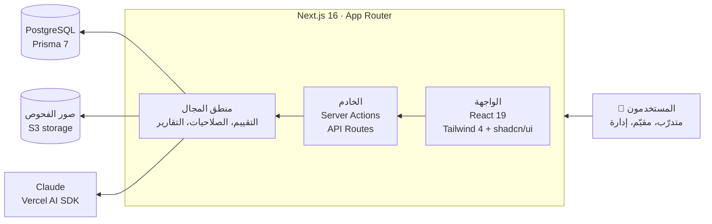

| الطبقة | التقنية |
|---|---|
| الواجهة والخادم |    |
| التصميم واللغات |    |
| البيانات |    |
| المصادقة |  أدوار، مؤسسات ودعوات، تحديد معدّل الطلبات، حذف الحساب |
| الذكاء الاصطناعي |   رؤية للصور وملخّصات، بمخرجات منظّمة وحدّ يومي لكل مستخدم |
| النشر |  التطبيق وقاعدة البيانات والتخزين |
| الجودة |    |

## 🔒 الأمان والخصوصية

- 🛡️ **ترويسات أمان صارمة:** سياسة أمان المحتوى (CSP) وHSTS وغيرها.
- 🖼️ **الصور:** تُزال بيانات الموقع (EXIF/GPS) داخل المتصفح قبل الرفع، ويُتحقّق من نوع الملف الفعلي، وتُحذف الصور تلقائيًا بعد مدة الاحتفاظ.
- 🏢 **فصل صارم** لبيانات كل مؤسسة عن غيرها.
- 📝 **سجل تدقيق** لكل عملية حساسة، وسجلات خادم بلا بيانات شخصية.
- ⏱️ **حدود للاستخدام:** تحديد معدّل لطلبات الدخول، وحدّ يومي لاستدعاءات الذكاء الاصطناعي لكل مستخدم.
- 🗑️ **حذف الحساب** مع تنظيف البيانات المرتبطة به.

## ✅ الجودة والاختبارات

| الفحص | الأداة | الحجم |
|---|---|---|
| اختبارات الوحدات | Vitest | 116 ملف اختبار |
| اختبارات شاملة على سطح المكتب والجوال | Playwright + فحص إمكانية الوصول (axe) | 42 ملف اختبار |
| الأنواع والتنسيق | TypeScript · ESLint (بلا أي تحذير) | كل الكود |
| اكتمال الترجمة | فحص مفاتيح العربية والإنجليزية | كل النصوص |
| التكامل المستمر | GitHub Actions على كل دفعة | تلقائي |

## 🗂️ هيكل المستودع

<div dir="ltr">

```text
.
├── app/
│   ├── [locale]/        # pages in Arabic & English: landing, auth, app, account
│   └── api/             # scans, simulations, reports, admin, health
├── components/          # UI components per feature
├── lib/                 # domain logic: scoring, AI, scans, simulations, reports, permissions
├── messages/            # UI strings: ar/ and en/
├── prisma/              # schema, migrations, seed (protocols & scenarios)
├── e2e/                 # Playwright end-to-end tests
└── docs/                # screenshots, explainer video, README assets
```

</div>

## 💻 التشغيل محليًا

**المتطلبات:** Node 24 · pnpm 11 · PostgreSQL (مثلًا عبر Docker).

<div dir="ltr">

```bash
cp .env.example .env.local      # BETTER_AUTH_SECRET, DATABASE_URL, optional ANTHROPIC_API_KEY
pnpm install
pnpm db:migrate                 # apply migrations
pnpm db:seed                    # protocols & scenarios
ADMIN_EMAIL=you@example.com ADMIN_INITIAL_PASSWORD='<long random password>' pnpm db:seed-admin
pnpm dev                        # http://localhost:3000
```

</div>

- بدون مفتاح الذكاء الاصطناعي تعمل المنصّة وتعرض "الذكاء الاصطناعي غير مُعدّ".
- مع `EMAIL_PROVIDER=console` تظهر رموز التحقق في سجل الخادم.
- لتشغيل كل الفحوص: `pnpm typecheck && pnpm lint && pnpm test && pnpm i18n:check && pnpm build`

> 🔐 لا يحتوي المستودع على أي أسرار أو كلمات مرور أو مفاتيح. كل المتغيرات موثّقة بقيم فارغة في [`.env.example`](.env.example).

## ⚖️ الحقوق والاستخدام

هذا المستودع **للاطلاع فقط** من قِبل لجنة تحكيم الهاكاثون، ولا يحمل أي رخصة مفتوحة المصدر.
جميع الحقوق محفوظة لفريق وقاية © 2026. لا يُسمح بنسخ الكود أو استخدامه أو تعديله أو إعادة نشره أو توزيعه، كليًا أو جزئيًا، دون إذن كتابي مسبق.

<div align="center">
<br>

<a href="https://web-production-88238.up.railway.app"></a>

<b>وقاية</b> · من اكتشاف الخلل بعد وقوعه، إلى التنبّه له قبل أن يصبح خطرًا

<sub><a href="#top">⬆ العودة للأعلى</a></sub>

</div>

</div>
